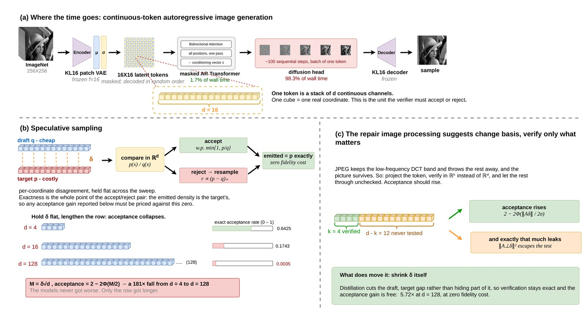
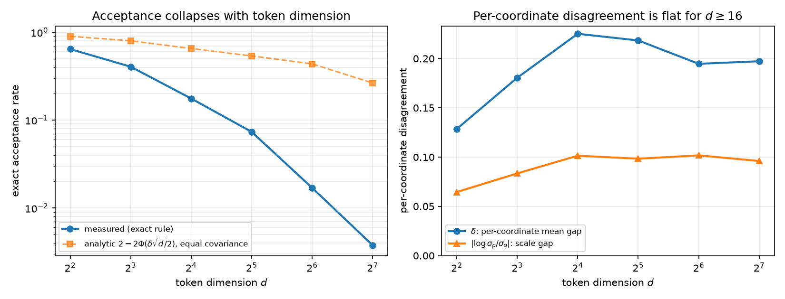
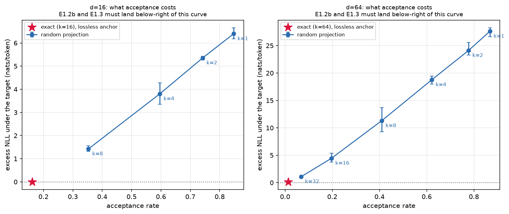
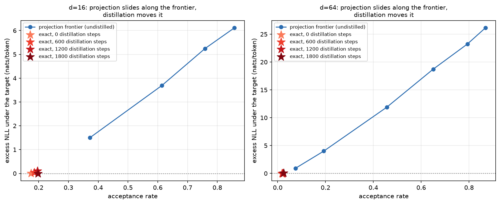

# HERALD

**The dimensionality barrier in continuous speculative sampling — and the distillation cure.**

Masked autoregressive image models such as [MAR](https://arxiv.org/abs/2406.11838) generate an
image as a grid of continuous tokens, each drawn from a small diffusion head that takes about 98% of
generation time. Speculative sampling is the standard lossless way to cut that latency, and
[CSpD](https://arxiv.org/abs/2411.11925) brought it to continuous tokens. This repository measures
when exact continuous speculative verification can work at all, why the transform-coding repair
fails, and which lever actually moves the frontier.

<p align="center">
  
</p>

<p align="center"><em>Figure — (a) Where MAR spends its time. (b) Exact speculative sampling collapses as token width grows at fixed per-coordinate gap. (c) Verifying a low-dimensional projection hides disagreement rather than removing it; distillation shrinks the gap itself.</em></p>

## Findings

1. **Exact acceptance collapses with token width.** For a draft and target that disagree by a fixed
   amount per coordinate, acceptance is `2 - 2Φ(δ√d / 2)`: a Gaussian tail in `√d`. Across three
   seeds, acceptance falls **174×** (0.627 → 0.004) as the token widens from `d=4` to `d=128` while
   the per-coordinate gap stays flat (**181×** on the baseline sweep). A training-free Gaussian
   reference follows the same curve to `d=4096`.
2. **Verifying a projection cannot escape it.** By the chain rule for KL divergence, an orthonormal
   projection leaves the total draft–target divergence unchanged and only decides how much of it the
   test sees. Five subspace rules (random, PCA, signal-top, DCT-low, and an anti-control) span 48
   nats of cost yet lie within **4.0%** of one acceptance–fidelity curve. An oracle given the true
   disagreement directions does no better.
3. **The image decoder offers no band to exploit.** Over 50 MAR-B latents, the KL16 decoder's
   Jacobian has effective rank 61.6 of 64. Its spectrum decays far more slowly than the DCT spectrum
   of the images it produces.
4. **Distillation is the lever that works.** Mode-covering KL distillation pulls the draft toward
   the target, cuts `KL(p‖q)` by 21–32%, and raises exact acceptance by up to
   **6.23±1.70×** at `d=128` across seeds (**4.76±0.64×** across 3-fold chronological CV), at zero
   fidelity cost. The gain grows with dimension.

On a real model pair, MAR-B and MAR-H sit a median 0.28σ apart per coordinate at `d=16`, which
predicts an exact acceptance of about 0.40 for one token and effectively zero for an image-width
block.

The name comes from the project's starting hypothesis: verify a learned low-dimensional semantic
statistic (from a JEPA encoder) under a conformal guarantee. Finding 2 is why that plan cannot beat
the frontier, and the repository now documents the barrier — and the distillation cure — instead.

## Key results

Multi-seed (`s ∈ {0,1,2}`, Fold 3) and 3-fold expanding chronological CV (`s=0`) across token widths.
Distillation cuts `KL(p‖q)` at zero fidelity cost; its gain grows with `d`.

| d | collapse acc. (seeds) | distill gain (seeds) | distill gain (CV) | KL drop (seeds) |
| --- | --- | --- | --- | --- |
| 4 | 0.627 ± 0.008 | 1.10 ± 0.01× | 1.10 ± 0.01× | 32.4 ± 3.2% |
| 8 | 0.387 ± 0.017 | 1.20 ± 0.03× | 1.20 ± 0.03× | 27.0 ± 0.7% |
| 16 | 0.188 ± 0.013 | 1.33 ± 0.01× | 1.33 ± 0.07× | 23.6 ± 2.3% |
| 32 | 0.070 ± 0.008 | 1.69 ± 0.13× | 1.95 ± 0.51× | 24.1 ± 4.8% |
| 64 | 0.020 ± 0.002 | 2.74 ± 0.35× | 2.84 ± 0.33× | 24.5 ± 0.8% |
| 128 | 0.004 ± 0.002 | **6.23 ± 1.70×** | **4.76 ± 0.64×** | 26.1 ± 2.5% |

<p align="center">
  
</p>

<p align="center">
  
  &nbsp;
  
</p>

## Why a testbed

A released KL16 checkpoint is fixed at `d=16`, so an image pipeline gives one point on the
acceptance-versus-width curve. The main sweeps therefore use a structurally matched continuous-token
system in which `d` is a constructor argument: a patch VAE over multichannel time-series windows
(ETTh1), a masked autoregressive transformer, and a Gaussian-mixture per-token head that keeps the
acceptance ratio in closed form. The sweep includes `d=16`. The 1-D DCT of a window plays the role
the 2-D DCT plays in JPEG. Image-side measurements (latency, decoder spectrum, MAR-B/MAR-H
separation) run on the public MAR checkpoints.

Robustness checks use three independent seeds on the standard 70/10/20 split and 3-fold expanding
chronological cross-validation with disjoint future test blocks.

## Setup

```bash
conda create -n herald python=3.10 && conda activate herald
pip install torch==2.5.1 torchvision==0.20.1 --index-url https://download.pytorch.org/whl/cu121
pip install -e ".[dev]"

bash scripts/setup_baselines.sh       # clone MAR, CSpD, D-JEPA, jepa-guidance into baselines/
bash scripts/download_checkpoints.sh  # MAR, D-JEPA and KL16 VAE weights into checkpoints/

pytest                                # unit tests for the acceptance rules, emitters and metrics
```

The experiments were run on RTX A6000 GPUs with CUDA 12.1. The analytic results (E0.3a, E0.8) and
the emitter check need no GPU.

## Reproducing the results

Each run writes `config.json`, `results.json` and a log under `experiments/<id>/` (git-ignored).
`docs/EXPERIMENT_LOG.md` records the exact command, the numbers, and what each result changed.

| Result | Experiment | Script |
| --- | --- | --- |
| Diffusion head is 98.3% of MAR wall time | E0.1 | `scripts/run_e01.py` |
| What CSpD's acceptance test computes on MAR pairs | E0.3, E0.3a | `scripts/run_e03.py`, `scripts/analyze_cspd_fixed_term.py` |
| KL16 decoder has no compact perceptual band | E0.5, E0.5b | `scripts/run_e05.py`, `scripts/plot_e05_spectrum.py` |
| MAR-B vs MAR-H separation | E0.6, E0.7 | `scripts/run_e06.py`, `scripts/run_e07.py` |
| Analytic reference and feasibility map | E0.8 | `scripts/run_e08.py`, `scripts/plot_e08_feasibility.py` |
| Acceptance collapses with token width | E1.1 | `scripts/run_e11.py` |
| Collapse is not a training-budget artefact | E1.1b, E1.1c | `scripts/run_e11b.py`, `scripts/analyze_e11b.py` |
| Random-projection null control | E1.2a, E1.2-frontier | `scripts/run_e12a.py`, `scripts/run_e12_frontier.py` |
| Five subspace rules, one frontier | E1.2b | `scripts/run_e12b.py`, `scripts/analyze_e12b.py`, `scripts/bootstrap_frontier.py` |
| Oracle subspace does not escape | E1.2c | `scripts/run_e12c_oracle.py` |
| Projected verification's emitted distribution | | `scripts/check_projected_emitter.py` |
| Distillation moves the frontier | E1.4, E1.5 | `scripts/run_e14.py`, `scripts/measure_distillation_divergence.py` |
| Multi-seed + chronological CV confirmation | E1.6 | `scripts/run_e16_cv_seeds.py` |

## Layout

```
herald/
├── verifiers/     exact token-space rule, CSpD's rule, projected and structured-subspace rules
├── eval/          acceptance and fidelity measurement for a full speculative step
├── models/        MAR and CSpD adapters; time-series tokenizer and masked AR model
├── metrics/       NFE accounting, pixel-domain metrics, KL16 decoder sensitivity
├── train/         training harness for the time-series testbed
├── data/          time-series loaders and chronological CV splits
└── calibration/   conformal risk control (from the original hypothesis)
scripts/           one entry point per experiment, plus analysis and plotting
tests/             unit tests
docs/              experiment log, research plan, related-work notes, result figures
```

Paper sources, course slides, and presentation decks are kept out of this repository (local /
Overleaf only).

## References

- MAR: Li et al., *Autoregressive Image Generation without Vector Quantization*, NeurIPS 2024.
  [arXiv:2406.11838](https://arxiv.org/abs/2406.11838)
- CSpD: Wang et al., *Continuous Speculative Decoding for Autoregressive Image Generation*, 2024.
  [arXiv:2411.11925](https://arxiv.org/abs/2411.11925)
- Leviathan et al., *Fast Inference from Transformers via Speculative Decoding*, ICML 2023.
  [arXiv:2211.17192](https://arxiv.org/abs/2211.17192)
- DistillSpec: Zhou et al., *DistillSpec: Improving Speculative Decoding via Knowledge Distillation*, 2024.
  [arXiv:2310.08461](https://arxiv.org/abs/2310.08461)
- D-JEPA: [arXiv:2410.03755](https://arxiv.org/abs/2410.03755), ICLR 2025.

## Author

Adele Chinda
